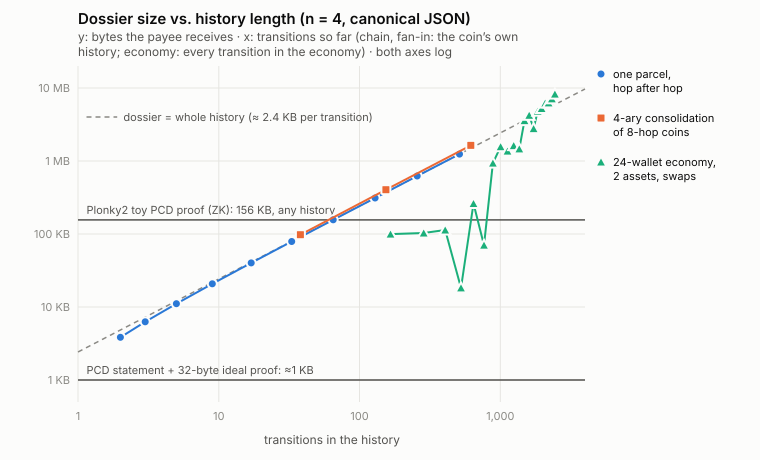

# Recursive proofs of ancestry validity

*Phase 3 (#10) research. Status: design and prototypes; nothing here changes the v0 protocol. Code lives in [`research/`](../../research). The guest-program spec is in [GUEST_STEP.md](GUEST_STEP.md).*

## Summary

**Problem, measured.** A dossier costs about **2.4 KB of JSON (0.9 KB binary) per transition** at *n* = 4, and about 9 KB per transition at *n* = 31. A cold holder spends about **0.75 ms per transition** verifying it in Python. That would be tolerable if dossiers stayed short, but they don't. In a simulated 24-wallet economy with two assets and swaps, after 2,400 steps the dossier a payee received covered **83 % of every transition ever made in that economy, across both assets**: 2,028 transitions, 8.2 MB, 2.9 s to verify cold. Mixing makes a coin's ancestry converge on the whole ledger. Every payee also learns all of it: every amount, key, home and vote time, including the other asset's history through swaps.

**Recommendation.** Use **proof-carrying data (PCD) at the granularity of a transition**. Each transition carries one proof that it is valid and that each of its inputs came from a transition that itself had such a proof. The proof's public statement contains no history. It holds only the output commitments and the trust footprint: the charters relied on, vote slack, excluded witnesses and deep-confirmation versions. Each holder applies **its own** policy to that footprint. Build it in a **general-purpose zkVM (RISC Zero or SP1, decided by M1/M2 benchmarks)** by porting the step function to Rust. That port would be shared with the Phase 2 Rust code, and recursion handles fan-in. Do not hand-write circuits for v1. **Do not switch hash function for v1**: hashing and encoding are under 3 % of the guest's cost. **Signatures are 96–98 %**, so the levers are Ed25519 precompiles, seals trimmed toward *q* votes, and signature-scheme agility in charters, not Poseidon.

**Prototyped.**
1. **Real recursive ZK proofs (Plonky2, toy statement).** Fan-in-2 PCD over a transition DAG with conservation, owner authorisation, existence of inputs, and a homes-relied-on output checked by holder policy. Proof **156 KB**, verify **6.9 ms**, prove **6.6–8.8 s per step** on 4 CPU cores with zero knowledge on, the same at any depth. All ten negative checks fail as they should.
2. **The real step relation as an RV32IM guest.** It computes the same statement digest as the Python reference on all 10 test vectors and costs **17 M instructions** for a one-input payment at *n* = 4.
3. **A faithful non-ZK PCD reference** in Python with a pluggable succinct-verifier seam. 23 tests, including 600-mutation differential fuzzing against `sigil.validate`.

No SP1 or RISC Zero proof was produced. Their installers (`risczero.com`, `sp1up.succinct.xyz`) and GitHub release downloads are blocked by this environment's egress policy. crates.io works, which is why Plonky2 and a self-built RV32 emulator stood in.

---

## 1. The problem, measured

`python3 -m research.measure_dossiers` builds histories with the reference `sigil.Wallet` on the in-process network and measures the dossier handed to each payee (`Dossier.ancestry([tid])`). It reports transitions, seals, votes, canonical-JSON bytes, zlib bytes, an estimate of a compact binary encoding (hex counted as raw bytes), and verification time for a holder with an empty cache ("cold") and for the actual payee ("warm", with its cache). Raw results are in `research/results/`. Timings are single-threaded CPython with OpenSSL Ed25519.



**Worst case 1: a long chain** (one parcel paid on in full each hop, alternating two homes, *n* = 4). Growth is linear: about 2.4 KB and 0.7 ms per hop.

| hops | transitions | votes | JSON | zlib | binary est. | verify (cold) |
|---:|---:|---:|---:|---:|---:|---:|
| 1 | 2 | 4 | 3.8 KB | 1.5 KB | 1.4 KB | 1.3 ms |
| 16 | 17 | 64 | 40 KB | 11 KB | 15 KB | 21 ms |
| 64 | 65 | 256 | 157 KB | 46 KB | 58 KB | 50 ms |
| 256 | 257 | 1,024 | 622 KB | 191 KB | 232 KB | 208 ms |
| 512 | 513 | 2,048 | 1.24 MB | 384 KB | 463 KB | 367 ms |

**Worst case 2: fan-in.** A merchant collects *K* = 4 coins, each of which has travelled *H* = 8 hops, consolidates them and pays on. The process repeats *L* levels, so the dossier grows as *K^L·H*.

| level | leaf chains | transitions | votes | JSON | verify (cold) |
|---:|---:|---:|---:|---:|---:|
| 1 | 4 | 38 | 160 | 98 KB | 30 ms |
| 2 | 16 | 154 | 672 | 405 KB | 124 ms |
| 3 | 64 | 618 | 2,720 | 1.63 MB | 538 ms |

**Typical case: a mixing economy.** The simulation has 24 wallets, 2 assets, 3 homes and *n* = 4. It runs random payments with the wallet's coin selection, which merges inputs, plus an atomic swap every 15th step. Selected rows from 2,400 steps:

| step | transitions in payee's dossier | all transitions so far | coverage | JSON | new to payee | verify warm | verify cold |
|---:|---:|---:|---:|---:|---:|---:|---:|
| 120 | 35 | 166 | 21 % | 100 KB | 5 | 4.7 ms | 27 ms |
| 600 | 87 | 646 | 13 % | 262 KB | 1 | 0.9 ms | 77 ms |
| 960 | 457 | 1,006 | 45 % | 1.57 MB | 1 | 1.1 ms | 591 ms |
| 1,440 | 963 | 1,486 | 65 % | 3.58 MB | 19 | 28 ms | 1.56 s |
| 1,920 | 1,342 | 1,966 | 68 % | 5.23 MB | 48 | 122 ms | 1.75 s |
| 2,400 | 2,028 | 2,446 | 83 % | 8.25 MB | 48 | 74 ms | 2.93 s |

**Seal size dominates.** Here is a 32-hop chain by constellation size. The reference wallet keeps every vote it collects, so seals hold *n* votes, not *q*.

| n | quorum | bytes / hop (JSON) | bytes / hop (binary est.) | verify 32 hops (cold) |
|---:|---:|---:|---:|---:|
| 4 | 3 | 2,468 | 918 | 29 ms |
| 7 | 5 | 3,201 | 1,248 | 38 ms |
| 16 | 11 | 5,399 | 2,238 | 100 ms |
| 31 | 21 | 9,063 | 3,888 | 178 ms |

**Takeaways**

* Dossier cost is linear in ancestry size, and **ancestry size is not bounded by hops**. Merges and swaps union histories, and in a mixing economy coverage climbs toward the whole ledger: 65–83 % after about 1,500 steps here, still rising. A long-lived coin effectively carries a per-asset blockchain, and through swaps a multi-asset one.
* Verifier caching works for *repeat* holders: the warm cost stays in milliseconds, because only 1–48 transitions are new. It does nothing for a **first-time** recipient, who pays the full cold cost, nor for bandwidth, nor for privacy.
* **Privacy leak.** The payee sees every transition body in the ancestry: amounts, assets, lock keys (pseudonymous identities), homes, memos, and vote timestamps, which give timing. A swap leaks the counter-asset's history too.

## 2. What a proof must attest

### 2.1 The relation

Let `Step(W, {Φ_p}) → Φ` be the per-transition relation defined in [GUEST_STEP.md](GUEST_STEP.md) and in `research/pcd.py:step`. A proof `π_T` for transition `T` attests:

> There exists a witness `W` with `W.tid = T` such that `Step(W, {Φ_p}) = Φ_T`, and for every distinct parent `p` of `T` there exists a valid proof `π_p` (under an allowed step key) whose statement is `Φ_p`.

By induction, a valid `π_T` means every transition in `T`'s ancestry back to the asset geneses satisfies SPEC §6, **relative to the trust footprint in `Φ_T`**. The holder then applies its own policy to that footprint. Here is how each part of SPEC §6 maps onto the design:

| SPEC §6 check | Where it happens |
|---|---|
| 6.1 `H(header) = tid`, `H(body) = header.body` | in the step |
| 6.2 outputs well-formed | in the step |
| 6.3 genesis rules | in the step |
| 6.4 inputs: distinct refs and sigils; input exists and is valid | in the step: the opening must equal the parent statement's output commitment, and the parent proof is verified recursively |
| 6.4 `sigil(p) = header sigil`; seal exists, matches gen and home | in the step |
| 6.4 seal has *q* valid votes from a charter | in the step, against the charter body the prover supplies. Output: `(cid, version, H(charter), slack)` |
| 6.4 charter authenticity (chain of signatures) | **holder**: checks `H(charter)` against its own registry, whose chains it verifies as today. Version 0 is also checked in the step (it hashes to the cid) |
| 6.4 the policy trusts `p.home` | **holder**: every `cid` in `relied` must be trusted (policy is per-holder, see §2.3) |
| 6.4 convicted witnesses excluded | **split**: the step excludes `W.excluded` and records slack; the holder accepts only if, per charter, the convictions the prover did not exclude are at most the slack (§5.1) |
| 6.4 owner unlock (`eval` with `now = null`) | in the step, including the signed `expires` field from commit 4f52887 |
| 6.5 conservation and the mint-right rule | in the step |
| "To accept, trust its home" | **holder**, from the parcel opening |

### 2.2 Public inputs and outputs

| Field | Why it is public | Size |
|---|---|---|
| `v` (step key) | binds the statement to one program; lets a holder pin allowed versions | 32 B |
| `tid` | the payee's `ref` needs it to spend later; it binds child statements to parents | 32 B |
| `outputs[i] = H("pcd-output", {ref, parcel})` | the payee checks its opening against this. The salt hides the others | 32 B × outputs |
| `relied = [(cid, version, H(charter), slack)]` | the trust footprint: which charters' seals the whole history needs | ~100 B × distinct (cid, version) |
| `excluded` | the witnesses whose votes were not counted anywhere (intersection over the history) | 32 B × convictions |
| `confirmed = [(cid, min version, H(charter))]` | deep-confirmation footprint (§5.2) | ~100 B × homes |

What the statement deliberately does **not** contain: amounts, asset ids (they are inside the commitments; the payee learns its own from the opening), locks, any ancestor transition, the number of hops, or timing. Its size is bounded by the number of distinct constellation versions the history touched, **not by history length**. The Python reference measures about 1 KB for histories of any length over two homes (`ConstantSize` test, 40 hops). If constellations proliferate, `relied` can become a Merkle root, with the list sent alongside or padded to a fixed size (padding with extra trusted homes only makes the holder's check stricter, so it is safe).

### 2.3 Why trust must stay outside the proof

Trust policies are per-holder (whitepaper inversion 4). A proof that said "valid under policy P" would be useless to a holder with policy P′, and **recursion would break**: a parent proof made for Bob's policy can't be reused inside Carol's step. So the statement must be policy-independent. The step proves validity *relative to the seals it saw* and outputs exactly the facts any policy needs: which charters, with how much slack. `HolderPolicy.check_statement` in `research/pcd.py` is the policy side, and `PolicyIsTheHolders` in the tests shows one proof accepted or refused depending on the holder.

### 2.4 Things the proof does not give you

* **Uniqueness is not attested.** As today, "this sigil was consumed once" rests on seals and quorum intersection, not on the holder. One forensic ability is lost, though. A dossier lets a holder notice two transitions in its ancestry consuming the same sigil, which is evidence of a corrupt quorum. A proof hides that. Exposing a nullifier per consumed sigil would bring it back but makes the statement grow with history.
* **Time locks** stay as today: `now = null` inside the step, and witnesses enforce time.

## 3. Privacy: what the next holder learns

| | Dossier (today) | PCD |
|---|---|---|
| Ancestor amounts, assets, locks, memos | all | none |
| Ancestor timing (vote `time`) | all | none |
| Number and shape of ancestors | all | none (the toy's diagnostic counter would leak it; a production statement must not carry one) |
| Counter-asset history through swaps | all | none |
| Homes and charter versions relied on | all | yes, as a set (no counts, no order) |
| Minimum vote slack per charter | derivable | yes |
| Immediate transition id and its other outputs | full bodies | `tid`, plus hiding commitments |

Requirements and caveats:

* The proving system must be **zero-knowledge in the mode that is transmitted**. Plonky2 has to be built with `zero_knowledge = true` (the prototype measures both modes). RISC Zero documents its STARK receipts as zero-knowledge. For SP1 we could not confirm a zero-knowledge guarantee for the compressed STARK mode at the time of writing, so M2 must settle this before relying on it. A SNARK wrap (Groth16/PLONK) gives zero knowledge but brings a setup and is costly to recurse over.
* **Delegated proving leaks one hop, not the history.** A prover service sees one step witness (the current transition and input openings, roughly what the payee sees) plus the parents' *statements*. That makes outsourcing proving from phones much less dangerous than outsourcing a dossier.
* **Multi-party transitions.** The coordinator needs each input's opening and parent proof, as it needs openings today. Co-signers learn each other's statements, never their histories.
* **Witnesses** see what they see today: headers only.

## 4. Seals, Ed25519 and BLAKE2b inside a proof

### 4.1 Measured cost of the real step relation (RV32IM)

`python3 -m research.rv32_cycles.run` compiles the step relation to bare-metal `riscv32im-unknown-none-elf` (Rust, `ed25519-dalek` on its 32-bit backend, `blake2`, `serde_json`), runs it in an RV32IM emulator that counts retired instructions, and checks that the digest the guest computes equals `research/pcd.py`'s. All 10 vectors match. Retired instructions approximate zkVM cycles without precompiles. RISC Zero adds paging overhead, and both zkVMs can replace curve arithmetic with precompiles.

| transition | inputs | votes | witness | instructions | Ed25519 share | hashes |
|---|---:|---:|---:|---:|---:|---:|
| genesis | 0 | 0 | 0.7 KB | 0.16 M | 0 % | 4 |
| payment, *n* = 4 | 1 | 4 | 3.8 KB | 17.0 M | 96.5 % | 10 |
| payment, *n* = 7 | 1 | 7 | 4.7 KB | 27.0 M | 97.3 % | 10 |
| payment, *n* = 16 | 1 | 16 | 7.4 KB | 57.0 M | 98.2 % | 10 |
| payment, *n* = 31 | 1 | 31 | 12.1 KB | 107.0 M | 98.5 % | 10 |
| swap across 2 homes, *n* = 4 | 2 | 8 | 7.5 KB | 33.9 M | 96.7 % | 17 |
| merge of 5 inputs, *n* = 4 | 5 | 20 | 16.5 KB | 84.0 M | 97.7 % | 29 |

Unit costs: **Ed25519 verify ≈ 3.29 M instructions**. **BLAKE2b ≈ 6.5 k instructions per 128-byte block**: 64-bit arithmetic emulated on RV32, still cheap. Canonical JSON encoding costs about 25–40 instructions per byte and parsing about 25 per byte. A step costs roughly `0.2 M + 0.4 M × inputs + 3.3 M × (counted votes + unlock signatures)`.

**What this means.** Proving cost per payment is set by **the number of signatures in that one transition**, never by ancestry. Turning that into wall-clock time needs a proving rate that we could not measure here. As an *assumption to be replaced in M1/M2*: at 1 M cycles/s, a 17 M-cycle step takes about 17 s, and at 10 M cycles/s, under 2 s. Cheaper options, in order of expected payoff:

1. **Precompiles.** SP1 and RISC Zero both ship accelerated `curve25519-dalek`. Measure the per-verify saving in M1.
2. **Seal trimming.** Prove only the votes needed: *q* plus the slack the wallet wants against convictions (§5.1). Today's wallet keeps all *n*.
3. **Signature agility in charters.** Let a charter name its vote scheme, so a constellation can later adopt BLS aggregation (one pairing per seal, but today's votes sign per-witness `time`, so they would need a shared message) or a proof-friendly Schnorr variant, without a holder fork.

### 4.2 Should v1 switch hash or signature scheme?

* **Hash: no.** Hashing plus canonical encoding is under 3 % of the zkVM cost. Poseidon would help only a hand-written circuit (§7), at the price of tying the protocol to one field and to a younger primitive, and of slower native hashing at the witness. SHA-256 is precompiled in the zkVMs, but the gain is at most a few percent. **Do** replace canonical JSON with a fixed binary encoding in v1. The reason is cross-implementation determinism (floats, Unicode, integer width), not speed.
* **Signatures: not yet.** They dominate, but zkVM precompiles may close most of the gap while keeping Ed25519's fast native batch verification, which matters on the witness hot path. Decide after M1 measures precompile costs. Add scheme agility to charters now, because that part is cheap.
* For the **circuit route** (Plonky2/Plonky3, Nova), non-native Ed25519 and bit-oriented BLAKE2b are where the cost goes. That is the main reason not to take the circuit route for v1.

## 5. Convictions and deep confirmation

### 5.1 Conviction lists: excluded set plus slack

A holder's convicted set *X* grows over time and differs between holders, so proofs can't bake it in. The design:

* The prover excludes a set `E_T` it already knows about. For each charter version, the statement records **slack** = min over that charter's seals in the history of (counted votes − *q*). When statements are folded, `excluded` becomes the **intersection** of the provers' sets. That is sound: every seal had *q* + slack votes outside every prover's set, so in particular outside the intersection.
* The holder accepts only if, for every `(cid, v)` in `relied`, `|(X \ excluded) ∩ members(cid, v)| ≤ slack`. Then every seal still has *q* valid unconvicted votes, which is exactly `sigil.validate`'s rule. `test_convictions_use_up_slack` checks agreement with the dossier verifier for 1 conviction (accepted) and 2 (rejected) at *n* = 4.
* Re-proving with more exclusions needs the step witness, which only the step's creator has. So **slack is the main defence**: wallets should collect more than *q* votes when signatures are cheap. This trades directly against prover cost (§4.1).

### 5.2 Deep confirmation needs signed STATUS and happens at proof time

Deep confirmation (SPEC §9) asks each home's *current* charter whether every ancestor consumption `(s, g, tid)` is bound as claimed. With PCD the holder no longer has the ancestry, so it **can't ask**. Anything a verifier may later want to know about the ancestry must be checked at proof time and summarised in the statement. The prototype models this:

* **A proposed protocol extension: signed STATUS (`attest`).** A witness signs `{constellation, version, witness, sigil, gen, tid, time}` for its current binding (`attest_binding` in `research/pcd.py`). Today's STATUS answers are unsigned and therefore useless inside a proof.
* **At proof time,** the step requires *f*+1 attestations from the charter the prover presents for each input's home, and records `confirmed[cid] = min version` over the history. The holder requires, per home, that this version be within `confirm_lag` of the latest charter it knows. `DeepConfirmation` tests show acceptance, rejection as stale after a rotation, and successful re-confirmation by the new charter (rotation hands bindings over).
* **The catch: confirmations go stale and can't be refreshed without the ancestry.** A coin whose history was confirmed by charter *v* stays at *v*.
* **Worse, ZK hides long-range forgeries.** With dossiers, a forgery by retired keys leaves a conflicting vote that can surface as an equivocation proof. Inside a ZK proof nobody ever sees the forged vote, so bonds stop deterring it. **Recommendation for v1: forward-secure (key-evolving) vote keys.** Witnesses derive per-epoch keys and erase them when the epoch ends, so retired witnesses *cannot* sign old-epoch votes. Holders should also refuse charter versions retired longer than their bond horizon, which `relied` makes checkable.

## 6. Prototypes

### 6.1 Real recursive ZK proofs: Plonky2 (`research/plonky2_pcd`)

A single cyclic circuit proves one transition and verifies **up to two child proofs of itself**: fan-in 2, so merges are native and a DAG needs nothing special. Statement: `asset`, two output commitments, `tid`, a 32-bit homes-relied-on mask, a diagnostic ancestry count, and the cyclic verifier data. The circuit enforces:

* Poseidon commitments.
* A genesis rule: the asset id equals the genesis tid, and outputs sum to supply.
* Each input opening equals a child's output commitment, so the input existed and was valid.
* Distinct inputs.
* 32-bit positive amounts with conservation.
* Owner authorisation as knowledge of a Poseidon preimage, a stand-in for the Ed25519 unlock.

The holder checks the mask against its trust set. **Not covered**: seals, the lock language, mint rights, multi-asset transitions, BLAKE2b and JSON. It is a toy *statement* on a real *proof system*.

Getting zero knowledge took a workaround. Plonky2's `dummy_circuit` refuses zero-knowledge configs, so the prototype builds its own shape-matched "filler" circuit for unused input slots. Soundness is unaffected because nothing from a filler proof is read.

Results on 4 CPU cores (`research/results/plonky2_pcd_*`):

| | non-ZK | ZK |
|---|---:|---:|
| circuit | 12,435 gates (2^14) | 13,192 gates (2^15 after blinding) |
| one-time build | 32–37 s | 102–111 s |
| prove genesis / hop / 2-child merge | 3.0 / 3.1–4.6 / 2.9–3.9 s | 6.6 / 6.6–8.8 / 6.7–6.9 s |
| proof size (compressed) | 147 KB (134 KB) | 156 KB (144 KB) |
| verify | 6.4–7.6 ms | 6.9 ms |
| depth tested | 2 and 16 hops plus a merge (21 transitions in the tree) | 4 and 16 hops plus a merge |

Proof size and verification time are the same at depth 2 and depth 16 by construction. The ZK circuit sits just over 2^14. Trimming about 800 gates would roughly halve its proving time.

Negative checks, each confirmed to fail proving or verification:
* inflation;
* spending without the owner's key;
* a duplicate input;
* an input that its child proof does not commit;
* a parcel the proof does not commit;
* tampered public inputs;
* an untrusted home anywhere in the ancestry (while the same policy accepts a branch that avoids it);
* a fake genesis minting an existing asset;
* an input with no valid ancestry proof.

### 6.2 The real step as a zkVM-style guest (`research/rv32_cycles`)

This is described in §4.1. It is the closest available substitute for running SP1 or RISC Zero: the same Rust logic a guest would run, executed instruction by instruction on RV32IM, and it **agrees with the Python reference's statement digest on every vector**. That also checks that a Rust `serde_json` canonical encoder reproduces Python's on real data.

### 6.3 Non-ZK PCD reference (`research/pcd.py`, `research/test_pcd.py`)

* `step()` implements the relation. `Statement` is the public output. `HolderPolicy` applies trust, charter-registry, slack and confirmation policy to a statement. `prove_history()` proves an existing dossier bottom-up, one step per transition, each proved once.
* **Backend seam** (`prove` / `verify` / `proof_size`):
  * `TranscriptBackend`: the "proof" is the witness plus child proofs, and verifying re-runs `step` all the way down. This is today's dossier recast as the trivial PCD.
  * `IdealBackend`: mocks a succinct ZK system. It issues a 32-byte tag only after running `step`, and verification checks only the tag, in constant time and size. A real SP1, RISC Zero or Plonky2 backend plugs in behind the same three methods.
* **Tests (23, about 5 s):**
  * *Agreement with `sigil.validate` on honest histories:* payment, cross-constellation hop, 5-input merge, both swap legs, mint.
  * *Constant size:* 40 hops, a single proof checked per holder, statement plus proof under 1.2 KB while the dossier grows more than 15×.
  * *Rejections:* inflation, missing seal, seal short of quorum, missing owner authorisation, input not matching its parent's statement, missing parent proof, fake version-0 charter, forged proof object, wrong opening.
  * *Policy:* untrusted home, unknown charter version, convictions against slack, prover-side exclusion.
  * *Deep confirmation:* confirmed, stale after rotation, re-confirmed, too few attestations.
  * *Differential fuzzing:* random mutations of real dossiers (amounts, seals, votes, unlocks, salts, assets, generations, homes, memos, supply). The PCD verdict equals the dossier verdict on every case (150 by default, 600 run).

## 7. Options compared

Figures marked ≈ are order-of-magnitude, from public documentation and benchmarks as we know them. They need re-measuring in M1/M2 on our step. Measured numbers are ours.

| | zkVM: **RISC Zero** | zkVM: **SP1** | zkVM: **Jolt** | Folding / IVC: **Nova, HyperNova, ProtoStar** | STARK recursion: **Plonky2 / Plonky3** |
|---|---|---|---|---|---|
| Write the statement as | Rust (reuse SPEC §6 code) | Rust | Rust | R1CS / CCS circuit | circuit (Plonky2), AIR (Plonky3) |
| Our step's cost | 17–107 M cycles without precompiles (measured instruction counts) | same | same | non-native Ed25519 in-circuit: ≈ 10^5–10^6 constraints per verify | measured: 12.4 k gates for the toy step; real seals ≈ 10^5–10^6 gates per signature |
| Recursion / fan-in | composition (`env::verify`), any *k* | `verify_sp1_proof` in guest, any *k* | in progress | IVC is linear; DAG fan-in needs multi-folding or PCD extensions (research code) | cyclic recursion, any *k* (fan-in 2 shown) |
| Proof size | ≈ 200 KB succinct; ≈ 0.3 KB Groth16 wrap | ≈ MB-scale compressed STARK; ≈ 0.3–0.9 KB Groth16/PLONK wrap | ≈ 10s–100s KB | ≈ 10 KB after Spartan compression | measured 134–156 KB |
| Verifier | ≈ ms (STARK) / ≈ 1–3 ms (Groth16) | same | ≈ ms | ≈ 10s ms | measured 7 ms |
| Prover | GPU ≈ seconds per 10^7 cycles; CPU much slower | GPU-optimised, similar or faster | fast-prover claims | cheapest per step (≈ one MSM of step size); good for client-side proving | measured 3–9 s per step on 4 cores |
| Setup | transparent; Groth16 wrap uses a ceremony | same | transparent | transparent (Pasta / IPA) or curve-cycle dependent | transparent |
| Zero knowledge | documented for receipts | to be confirmed for compressed STARKs; wrap is ZK | in progress | needs a ZK variant (HyperNova has one) | config flag; works with our filler-circuit workaround |
| Maturity | production, audited, 1.x+ | production, audited | research to early production | research libraries, unaudited | Plonky2 production-used (needs nightly Rust); Plonky3 maturing, underlies newer zkVMs |
| Hash / signature friendliness | SHA-256 and curve25519 accelerated; BLAKE2b in software (measured cheap) | SHA-256, Keccak, curve25519 precompiles | lookup-based | Poseidon and native-field Schnorr only | Poseidon / Poseidon2 only; non-native Ed25519 painful |
| Post-quantum | STARK core plausible; Groth16 wrap no | same | no (curve-based PCS) | no | plausible |

Precedents worth studying: Mina's Pickles (production PCD with up to two predecessors per step, the same fan-in shape), Zexe/Aleo (private UTXO with proofs), and Zcash's Halo 2 recursion.

## 8. Recommended path and milestones

The guiding principle: **the step function is the product, and the proving system is a plug-in.** The statement format, holder policy and test vectors from this work are meant to outlive any one backend.

| Milestone | Deliverable | Exit criterion |
|---|---|---|
| **M0** (this work) | Statement spec, Python reference with tests and fuzzing, guest spec, RV32 cost model, Plonky2 PCD | done |
| **M1: real executors** | Port `step` to a Rust crate shared with Phase 2. Run it in the SP1 and RISC Zero executors (no proving) on `research/rv32_cycles` vectors, with and without curve25519 precompiles. Pin a binary encoding | digests equal the Python reference; cycles/step known per backend; precompile saving measured |
| **M2: real recursive proofs** | Fan-in *k* recursion in the chosen zkVM. Prove/verify benchmarks (CPU, single GPU). Confirm ZK of the transmitted mode. A real `Backend` behind `research/pcd.py`'s seam | verify ≤ 50 ms, proof ≤ 300 KB, typical step proved ≤ 30 s on one GPU; `test_pcd` passes against the real backend |
| **M3: protocol integration** | Proof objects in WIRE.md. Wallet receive-by-proof path. **Hybrid acceptance** (a step may take a parent as a proof *or* as a raw transition, so dossiers and proofs interoperate during rollout). Signed STATUS (`attest`). Charter-declared vote scheme. Statement policy in `TrustPolicy` | end-to-end testnet payment verified from a proof only |
| **M4: v1 crypto decisions and audit** | Forward-secure vote keys; binary encoding; seal trimming policy; allowed-step-key lists in holder policy; reproducible guest builds; audit of the guest | spec frozen with v1 |
| **M5: reach** | Delegated proving service (leaks one hop), proof batching for consolidations, optional SNARK export for constrained verifiers; evaluate folding schemes for on-device proving | phone wallet receives and spends with proofs |

## 9. Open questions and risks

1. **A soundness bug in the proving system or guest becomes silent, unlimited inflation.** Hidden histories mean nobody can audit supply after the fact. Mitigations:
   * pinned allow-lists of step keys in holder policy, with a kill switch;
   * two independent backends for high-value receipts ("proof diversity");
   * dossiers on request for high-value payments;
   * wallets keep encrypted dossiers of their own steps for a while (the "right to re-prove").
2. **Prover cost and latency on wallets.** With current zkVMs, 17–107 M cycles per payment is not phone-friendly. Delegation limits the leak to one hop, but someone must pay for it. Proof generation could also be *lazy*: pay trusted counterparties with dossiers and compact into proofs in the background.
3. **ZK of the transmitted proof mode** must be confirmed per backend (§3). A Groth16 wrap brings a trusted setup and is expensive to recurse over.
4. **Long-range forgery becomes invisible under ZK** (§5.2). Forward-secure vote keys are the clean fix but a v1 protocol change. Deep-confirmation staleness has no refresh path without the ancestry.
5. **Lost forensics.** Double-consumption evidence inside an ancestry is no longer visible to holders (§2.4).
6. **The relied set leaks and grows** with the number of constellations a coin's history touched. Padding and Merkle commitments help. Is that leakage acceptable?
7. **Upgrades.** Every guest change changes the step key. Old proofs must stay usable through an allow-list compiled into the guest, and the allow-list policy needs governance-free distribution, presumably like charters.
8. **Encoding determinism** across implementations. It is cross-checked here on real vectors, not proven. This is a reason for the v1 binary encoding.
9. **Equivocation and slack trade-off.** More votes give more conviction slack but cost about 3.3 M cycles each. The right default is a policy question.
10. **Post-quantum.** Ed25519 everywhere and any SNARK wrap are not PQ. STARK recursion is PQ-plausible.
11. **Interaction with Phase 4.** Issuer redemption shortens histories and complements proofs. Succession must keep `relied` charters resolvable after a constellation dies.

## Reproduce

```sh
python3 -m research.measure_dossiers --json research/results/dossier_growth.json      # §1 (≈ 3 min)
python3 -m research.measure_dossiers --only economy --economy-payments 2400 \
        --json research/results/economy_2400.json                                    # §1 economy (≈ 2 min)
python3 -m research.plot_growth                                                       # the chart
python3 -m unittest research.test_pcd -v                                              # §6.3 (SIGIL_PCD_FUZZ=600 for more)
rustup target add riscv32im-unknown-none-elf && python3 -m research.rv32_cycles.run   # §4.1
rustup toolchain install nightly && sh research/plonky2_pcd/run.sh 16                 # §6.1 (≈ 8 min)
```

Note on the code base: at commit 4f52887 `locks.sign_unlock` requires `expires`, but `Wallet.authorise` doesn't pass it yet (its follow-up commit is pending). `research/_compat.py` detects exactly that state and patches a faithful copy of `authorise` that signs `expires = now + 3600`. It does nothing once the wallet is fixed. Nothing under `sigil/` was modified.
